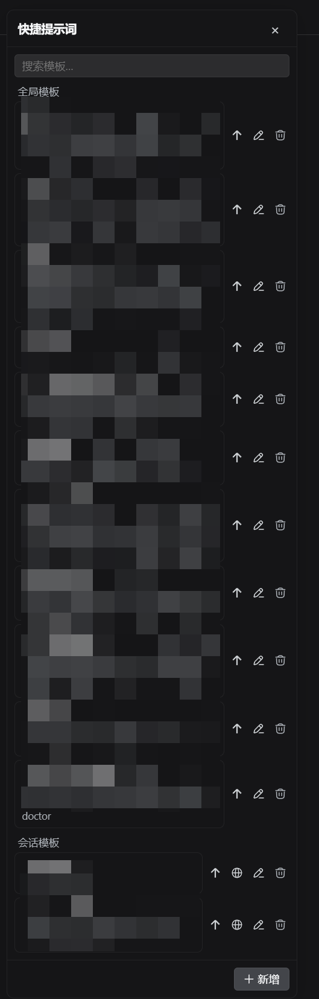

# @nelsonlongxiang/dsh-prompt-templates

English | [中文](README_zh.md)

[](https://www.npmjs.com/package/@nelsonlongxiang/dsh-prompt-templates)

Quick prompt templates for [DeepSeek Harness](https://github.com/deepseek-ai/deepseek-harness): global and per-session templates, a right-side browser panel, and pure-TS SQLite persistence via `node:sqlite` — one self-contained plugin, installable with `dsh plugin`.



## Install

```sh
dsh plugin --profile web add @nelsonlongxiang/dsh-prompt-templates
```

Restart `dsh web`, then look for the templates button in the composer tool row. Since 0.12.0 the same library is also a **right-sidebar tab**: open it from the sidebar's `+` guide page (entry “Prompt templates”) — it lives beside the conversation, keeps the composer visible, and always targets the session the sidebar is viewing. On hosts without the sidebar services the tab stays dormant and the floating panel keeps working.

No Python toolchain required — since 0.3.0 the host half persists templates through `node:sqlite` (Node ≥ 24) directly inside the host process, reading and writing the same `$DSH_HOME/ext/prompt-templates/db.sqlite3` the former Python child owned (zero data migration).

## What you get

- **Global + per-session templates** — globals apply everywhere; session templates stay private to one conversation and can be promoted to global in one click
- **Scheduled auto-injection** — per-template switch and interval: the host re-surfaces an enabled template into the model context at the first request of every Nth round, persisted in SQLite and logged as a durable session event; the library toolbar shows a `⟳N` badge with the session's latest injection (turn, time, template names)
- **Insert or send** — one click inserts the template at the composer caret (or replaces the current selection); send-now dispatches immediately; edit, delete, and make-global all live in the row
- **Right-sidebar tab** — the full library also docks as a sidebar tab (DSH ≥ 0.2.x): open it from the `+` guide and it follows the session you are viewing; the floating panel remains for quick one-shot use
- **Search & scroll** — filter the list as you type, reliable scrolling for long collections
- **Drag to reposition, double-click to reset** — the panel remembers where you put it
- **Durable by design** — templates persist in SQLite through a pure-TS store (`node:sqlite`) owned by the host plugin and closed with its lifecycle

## Auto-inject

Each template (global or session-scoped) carries its own **switch + interval N**. When on, the host injects the template at the first request of every Nth round of the conversation — N=5 means rounds 5, 10, 15, …; rounds count user→assistant exchanges and keep their numbering across restarts.

- The injected content arrives as one durable `<system-reminder>` user message recorded in the session log (source kind `prompt-template-schedule`), so replays and audits reconstruct exactly what the model saw
- A boundary round is never injected twice, even across restarts or step retries
- Config persists in the plugin's SQLite database (schema v3); the deployment can silence everything with `injectEnabled: false` in the patch config

## How it works

```text
src/                  TypeScript plugin (host half + browser half)
  index.ts            Host: owns the TS store, exposes the HTTP routes
  store.ts            Pure-TS template store over node:sqlite (schema v3)
  inject.ts           Host: scheduled auto-injection on the pre-step waterfall
  invariant.ts        Host: registers the package's invariant companion
  cli/                The sync CLI (export/diff/merge/import) shipped as bin
  client/             Browser: shared template library mounted as both the
                      shell.overlay floating panel and the right-sidebar
                      tab body (sidebar.right.pane.tab), plus the
                      conversation.input.right toggle button
cordis.patch.yml      Bundle patch: mounts the plugin row
```

The store is pure TS inside the host half; no child process is spawned.

## Security

- Template content reaches a model request in exactly two ways: as ordinary user text the user chose to insert, or as scheduled auto-injection of templates where the switch was explicitly enabled — every injection is a durable session event
- The panel talks to the host store over the Host's plugin routes only; no extra listener, no outbound network

## Database sync CLI

The package ships a deterministic, local-only CLI for comparing and merging prompt-template databases across DSH homes. It never writes a remote database directly.

```sh
# Export a schema-v3 snapshot (canonical order + data_sha256)
dsh-prompt-templates export --db /path/to/db.sqlite3 --out snapshot.json --output=json

# Compare two snapshots (exit 1 with --fail-on-diff)
dsh-prompt-templates diff left.json right.json --output=json --fail-on-diff

# Merge into a JSON artifact only; equal-time or name conflicts block by default
dsh-prompt-templates merge base.json incoming.json --strategy newer --out merged.json --output=json

# Dry-run import (the default): review summary_sha256 and database hash
dsh-prompt-templates import --db /path/to/db.sqlite3 --in merged.json --output=json

# Apply only after binding both reviewed values; creates a backup, then one transaction
dsh-prompt-templates import --db /path/to/db.sqlite3 --in merged.json --apply \
  --expect-db-sha256 <db-sha256> --confirm-summary-hash <dry-run-summary-sha256> --output=json
```

`import` inserts/updates by template id and never prunes rows. It rejects unknown snapshot fields, unsupported schemas, mismatched hashes, same-name/different-id conflicts, and changes above `--max-changes` (default 100). Schema-v2 snapshots (pre-auto-inject) still import — the inject facts default to off; exports are always v3.

## Development

```sh
pnpm install
pnpm verify            # everyday gate (local and CI)
pnpm verify:release    # alias of pnpm verify
```

`pnpm verify` is the gate to run before pushing. It does not boot a DeepSeek Harness process. In order:

1. **typecheck** — `tsc --noEmit` for the host project and the client project
2. **test:cli** — `node:test` over `tests/*.test.ts`: CLI sync, store rules, schema migration, inject helpers, client filters, and an in-process host check. That check mounts `apply()` on Cordis with a stand-in web server, drives the `/plugins/dsh-prompt-templates` routes (including inject-status), and runs the `agent/pre-step` listener against a fake session log
3. **build** — host `tsc`, client `tsc`, and the tsdown browser bundle
4. **test:package** — every CSS module class is present in `lib/client.js`, then `npm pack` and the packed `dsh-prompt-templates --help` shim

GitHub Actions (`.github/workflows/verify.yml`) runs the same command on pushes and pull requests to `master`, and on `v*` tags, with Node 24. The `@deepseek-ai/*` devDependencies are public npm packages, so CI needs no registry token and no harness checkout.

Still manual, because they need a live harness profile: booting `dsh web`, the browser panel against the real web server, and resume or compaction against a real session log.

## Known limitations

- **Session templates need a current session** — with no session open, only global templates are reachable
- **Injections don't render in the chat transcript** — the DSH chat view omits injected context rows by design (they carry a non-`user` message source); see them in the trajectory tab. Templates with delivery mode **visible** are the exception: they render as ordinary user messages
- **Install from the npm registry, not from a Git URL** — the plugin compiles against the DSH harness checkout; `pnpm add github:<user>/<repo>` fails at the prepare build step because the published `@deepseek-ai/*` npm snapshots lag the harness source. Use `dsh plugin --profile <name> add @nelsonlongxiang/dsh-prompt-templates` instead

## License

MIT
