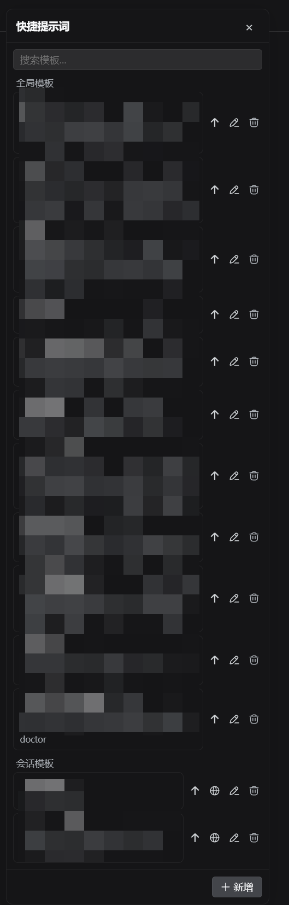

# @nelsonlongxiang/dsh-prompt-templates

English | [中文](README_zh.md)

[](https://www.npmjs.com/package/@nelsonlongxiang/dsh-prompt-templates)

Quick prompt templates for [DeepSeek Harness](https://github.com/deepseek-ai/deepseek-harness): global and per-session templates, a right-side browser panel, and pure-TS SQLite persistence via `node:sqlite` — one self-contained plugin, installable with `dsh plugin`.



## Install

```sh
dsh plugin --profile web add @nelsonlongxiang/dsh-prompt-templates
```

Restart `dsh web`, then look for the templates button in the composer tool row. Since 0.12.0 the same library is also a **right-sidebar tab**: open it from the sidebar's `+` guide page (entry “Prompt templates”) — it lives beside the conversation, keeps the composer visible, and always targets the session the sidebar is viewing. On hosts without the sidebar services the tab stays dormant and the floating panel keeps working.

No Python toolchain required — since 0.3.0 the host half persists templates through `node:sqlite` (Node ≥ 24) directly inside the host process, reading and writing the same `$DSH_HOME/ext/prompt-templates/db.sqlite3` the former Python child owned (zero data migration).

## What you get

- **Global + per-session templates** — globals apply everywhere; session templates stay private to one conversation and can be promoted to global in one click
- **Scheduled auto-injection** — per-template switch and interval: the host re-surfaces an enabled template into the model context at the first request of every Nth round, persisted in SQLite and logged as a durable session event; click the toolbar `⟳N` badge to open the session's last 20 injections (turn, time, template names, injected bodies)
- **Template variables** — content supports `{{date}}` `{{time}}` `{{datetime}}` `{{weekday}}` `{{session}}` `{{turn}}`, expanded at delivery across insert, send-now, interject, and scheduled injection; unresolved values stay literal and storage keeps the raw text
- **Cross-instance sharing** — copy one template or a whole category as a clipboard payload; paste-import on the target instance with an explicit same-name overwrite confirm
- **Insert or send** — one click inserts the template at the composer caret (or replaces the current selection); send-now dispatches immediately; edit, delete, and make-global all live in the row
- **Right-sidebar tab** — the full library also docks as a sidebar tab (DSH ≥ 0.2.x): open it from the `+` guide and it follows the session you are viewing; the floating panel remains for quick one-shot use
- **Search & scroll** — filter the list as you type, reliable scrolling for long collections
- **Drag to reposition, double-click to reset** — the panel remembers where you put it
- **Durable by design** — templates persist in SQLite through a pure-TS store (`node:sqlite`) owned by the host plugin and closed with its lifecycle
- **Card library and intervention log** (0.16) — templates carry an effective version; version packs (`packs/`) import as stored versions without switching what is live; every time template content enters a session a durable record keeps id, version, text hash, session, turn and step, never the bodies. See [library packs](docs/library-packs.md)
- **Wrap-up self-check and card casting** (0.17) — the self-check adds one step before a working session would end its turn; it is on by default since 0.19.0; opt out with `selfCheck.enabled: false`. `cast.enabled` (off by default) lets named plugins cast one card into a session. See [the self-check contract](docs/self-check.md)
- **Lessons and handoff notice** (0.18) — lessons are on by default since 0.19.0 (opt out with `lessons.enabled: false`) and let a session write one- or two-sentence lessons (its own session templates under the 体会 category) that are recalled in matching situations; the handoff notice follows the event-reminder switches (off by default): once an episode exhausts its reminders and repeats, one notice asks the session to stop self-correcting and hand over. Details: `docs/spec-lesson-inject.md` and `docs/release-notes-0.18.0.md` in the source repository

In 0.25.0, the next wrap-up check after upgrade uses `selfcheck-fixed-3`. The v4 evolution default is for sessions that have yet to enroll. Enrolled sessions retain their existing card. See the [0.25.0 release notes](https://github.com/NelsonLongxiang/dsh-prompt-templates/blob/888add480692904b9cd6f92495052eb2be808a12/docs/release-notes-0.25.0.md).

## Sharing (cross-instance copy)

- The row ⧉ button shares **one template**; the category tab ⧉ shares **a whole category** (member templates + the category definition)
- The **Share template JSON / Share category JSON** buttons share a self-describing payload (`format`/`version` markers), not just the prompt body. No files or network are used.
- Automatic copying tries the browser Clipboard API first, then a compatibility copy command. If both fail, a read-only **Copy share JSON manually** panel preserves exactly the same payload: select all, press Ctrl+C / ⌘C, and paste into the target instance Import box. The panel distinguishes unavailable API, unfocused page, denied write and security restriction; it does not diagnose a damaged system clipboard.
- Clipboard restrictions depend on the browser/context. Plain LAN HTTP may lack the API; loopback origins such as `http://127.0.0.1` can be trustworthy despite HTTP. No global security changes or clipboard-reading permission are needed.
- Paste into the toolbar **Import** box on the target instance: missing categories are created, and **same-name same-scope templates raise an explicit overwrite confirm** — overwrite updates the existing row (content/description/category/inject facts), declining skips; the result reports created/overwritten/skipped counts
- What is shared is the **raw text**: `{{date}}`/`{{turn}}` re-expand at delivery on the receiving instance

## Auto-inject

Each template (global or session-scoped) carries its own **switch + interval N**. When on, the host injects the template at the first request of every Nth round of the conversation — N=5 means rounds 5, 10, 15, …; rounds count user→assistant exchanges and keep their numbering across restarts.

- The injected content arrives as one durable `<system-reminder>` user message recorded in the session log (source kind `prompt-template-schedule`), so replays and audits reconstruct exactly what the model saw
- A boundary round is never injected twice, even across restarts or step retries
- Config persists in the plugin's SQLite database (database schema v11 as of 0.18.0, including evolution enrollment; the gate is `SCHEMA_VERSION` in `src/store.ts`); `injectEnabled: false` in the patch config silences **scheduled injection only** — event reminders (below) have their own independent master switch `eventInject.enabled`
- Each template picks a delivery mode: **silent** (default, model context only) or **visible in chat** (rendered as a normal user message with a ⚙️ scheduled-injection header)

## Atelier evolution checkpoint (since 0.15.0)

A session-scoped `工坊·演化自评估` template is provisioned once by default and scheduled every 100 user turns. Existing same-name global/session templates and user edits, disabling and deletion are preserved. This is a reminder, not migration execution or authorization. Set `evolutionAssessmentEnabled: false` to opt out. See [the lifecycle, counting and rollback contract](docs/evolution-default.md).

## Event reminders (off by default)

Besides fixed rounds, the plugin can remind the agent **because of what just happened**. It watches final tool results, detects two problems — **repeated preparation** (the same hand-built prefix such as environment variables plus an absolute interpreter path, with different tasks) and **repeated failure** (the same target failing the same way, or failing again after it had succeeded) — and appends one short reminder before the next model decision, including the tool-result steps that scheduled injection skips.

- Two switches in series: the master switch lives in the plugin database (the panel ⚙ dropdown toggles it, effective immediately without a restart; the deployment `eventInject.enabled` value only seeds it on first read) and each rule keeps its own toggle alongside threshold/cooldown and the read-only episode ledger. Owner ruling 2026-11-18: the master switch moved from deployment-config-only to panel-owned, reversing the 2026-11-14 posture.
- Timing: observation happens after a tool result; the reminder is appended before the **next model decision in the same turn**. It cannot block a first violation, and cannot undo side effects or already-issued sibling parallel calls
- What is stored: fingerprints (hashes) plus a length-bounded, heuristically redacted summary of the arguments. Raw arguments/output are not stored wholesale, but the summary may still carry argument fragments the redaction did not mask; it is never treated as an instruction or authorization
- Failure classification prioritizes `isError` and its error code, then an integer `meta.exitCode` (including zero). Only when metadata has no valid exit code does the `bash` adapter read the exact trailing `[exit code: N]` marker from the last text part. Arbitrary output words such as success or failure do not decide the result. A command can print a lookalike marker, so this fallback can produce a false positive; `ok` means tool-layer completion, not verified task success. See the [failure contract](docs/event-failure-contract.md) for priority, recorded-host limits, and untested cases.
- Budgeted: one reminder per **user turn** by default (long autonomous turns therefore get at most one), a character cap, a per-rule cooldown (3 turns by default), and a per-problem limit; no new evidence, no reminder
- Delivery is at-least-once with dedup against the session log, so restarts and rejected steps neither lose nor duplicate a reminder
- The plugin only marks a problem `notified`. The `changed` / `repeated` field is a weak behavioral hint, not a verdict: an unrelated command on the same tool can flip it. Closing an episode (`verified`, `rejected`, …) goes through `PATCH …/event-episodes/<id>` and requires evidence references — only a full-trajectory review counts as verification
- A reminder is a user-role message: not a user instruction, no extra permission. How an agent should handle it is defined in Agent Atelier's `references/improvement-loop.md`; the design is in [docs/spec-event-inject.md](docs/spec-event-inject.md)

## Template variables

Placeholders `{{date}}` `{{time}}` `{{datetime}}` `{{weekday}}` `{{session}}` `{{turn}}` expand **at delivery time** — insert, send-now, interject, and scheduled injection all expand:

- Clock variables read the local clock; `{{session}}` is the target session id; `{{turn}}` resolves only on the scheduled-injection path (it stays literal on insert/send)
- Unknown names pass through untouched — nothing is silently deleted; the template form shows a variable hint line
- Storage always keeps the raw text; expansion happens at the moment of delivery, so the history dropdown shows exactly what went out

## How it works

```text
src/                  TypeScript plugin (host half + browser half)
  index.ts            Host: owns the TS store, exposes the HTTP routes
  store.ts            Pure-TS store over node:sqlite (database schema v11)
  inject.ts           Host: scheduled auto-injection on the pre-step waterfall
  invariant.ts        Host: registers the package's invariant companion
  cli/                The sync CLI (export/diff/merge/import) shipped as bin
  client/             Browser: shared template library mounted as both the
                      shell.overlay floating panel and the right-sidebar
                      tab body (sidebar.right.pane.tab), plus the
                      conversation.input.right toggle button
cordis.patch.yml      Bundle patch: mounts the plugin row
```

The store is pure TS inside the host half; no child process is spawned.

## Security

- Template **content** reaches a model request in exactly two ways: as ordinary user text the user chose to insert, or through scheduled auto-injection. User templates follow their saved switches; the Atelier evolution default (shipped since 0.15.0) is enabled at once-per-session creation unless the deployment opts out, and remains editable/disableable/deletable by the user. Each delivered injection is a durable session event. The wrap-up self-check (`selfCheck.enabled`) and lessons (`lessons.enabled`) are further injection paths, on by default since 0.19.0 and turned off with `false` in deployment config; card casting (`cast.enabled`) stays off by default. Event reminders are a separate channel: they carry no template content, and their switch is independent of scheduled injection
- The panel talks to the host store over the Host's plugin routes only; no extra listener, no outbound network

## Database sync CLI

The package ships a deterministic, local-only CLI for comparing and merging prompt-template databases across DSH homes. It never writes a remote database directly.

```sh
# Export a schema-v4 snapshot (canonical order + data_sha256)
dsh-prompt-templates export --db /path/to/db.sqlite3 --out snapshot.json --output=json

# Compare two snapshots (exit 1 with --fail-on-diff)
dsh-prompt-templates diff left.json right.json --output=json --fail-on-diff

# Merge into a JSON artifact only; equal-time or name conflicts block by default
dsh-prompt-templates merge base.json incoming.json --strategy newer --out merged.json --output=json

# Dry-run import (the default): review summary_sha256 and database hash
dsh-prompt-templates import --db /path/to/db.sqlite3 --in merged.json --output=json

# Apply only after binding both reviewed values; creates a backup, then one transaction
dsh-prompt-templates import --db /path/to/db.sqlite3 --in merged.json --apply \
  --expect-db-sha256 <db-sha256> --confirm-summary-hash <dry-run-summary-sha256> --output=json
```

`import` inserts/updates by template id and never prunes rows. It rejects unknown snapshot fields, unsupported schemas, mismatched hashes, same-name/different-id conflicts, and changes above `--max-changes` (default 100). Schema-v2 snapshots (pre-auto-inject) still import — the inject facts default to off; exports are always schema v4 (templates/categories only, not event policies or runtime state).

## Repository layout

Declared layout — anything outside this allowlist at the repo root is scatter, and the patrol gate (`scripts/patrol.sh`, dir-convention section) fails on it:

| Path | Responsibility |
|---|---|
| `src/` | Host plugin, CLI, and browser-client sources |
| `scripts/` | Rerunnable ops entries: `patrol.sh`, `branch-audit.sh`, `remote-heads.sh`, `push-master.sh`, `release.sh` |
| `docs/` | Human-facing documents: specs, release notes, handover; the npm package ships only the explicitly listed user/acceptance guides |
| `tests/` | `node:test` suites behind `pnpm verify` |
| `images/` | Static assets referenced by the READMEs |
| `tmp/<task>/` | Git-ignored scratch; automated tests use `tmp/test-runs/` via `tests/temp-dir.mjs`; task lifetime only, never in git |
| `lib/`, `node_modules/` | Build output and dependencies — ignored, never tracked |
| `.npmrc`, `.claude/`, `.obelisk/` | Local tool state (registry config, workbench junctions, agent memories) — ignored, never tracked |

## Development

```sh
pnpm install
pnpm verify            # everyday gate (local and CI)
pnpm verify:release    # alias of pnpm verify
```

`pnpm verify` is the gate to run before pushing. It does not boot a DeepSeek Harness process. In order:

> **Windows: run it from Git Bash.** Under a PowerShell/cmd parent shell `bash` resolves to WSL first, which strips Windows env vars; the offline release-script suite (`tests/release-script.test.ts`) then skips itself with one explanatory line (`RELEASE_FIXTURE_STUBS` arrives empty, #31). From Git Bash all 40 run.

1. **typecheck** — `tsc --noEmit` for the host project and the client project
2. **test:cli** — `node:test` over `tests/*.test.ts`: CLI sync, store rules, schema migration, inject helpers, client filters, and an in-process host check. That check mounts `apply()` on Cordis with a stand-in web server, drives the `/plugins/dsh-prompt-templates` routes (including inject-status), and runs the `agent/pre-step` listener against a fake session log
3. **build** — host `tsc`, client `tsc`, and the tsdown browser bundle
4. **test:package** — every CSS module class is present in `lib/client.js`, then `npm pack` and the packed `dsh-prompt-templates --help` shim

GitHub Actions (`.github/workflows/verify.yml`) runs the same command with Node 24 on pushes and pull requests to `master` and on `v*` tags. `test:cli` also carries the DSH 0.2.x contract tests (peer version line, patch sandbox, real store execution, slot declarations, icon exports) — upstream drift fails the gate. Repo `scripts/` hold the stable ops entries (branch-budget audit, absorption classification, privacy-checked push). The `@deepseek-ai/*` devDependencies are public npm packages, so CI needs no registry token and no harness checkout.

A self-contained sharing test page can be generated with `node tests/clipboard-browser.mjs en` (or `zh`) after build. It includes synthetic copy scenarios and read-only environment checks; see [clipboard verification](docs/clipboard-verification.md) for privacy boundaries and macOS acceptance steps. Generating/parsing the page is not browser acceptance.

Still manual, because they need a live harness profile: booting `dsh web`, the browser panel against the real web server, and resume or compaction against a real session log.

### Maintainer release workflow

Publishing requires separate owner authorization. Use `bash scripts/release.sh "<subject>"` only on **master**, with either:

- a version-only package bump plus the matching non-empty release notes (all other changes already landed, and HEAD equals remote master); or
- a clean, exact `chore(release): <version> — <subject>` commit containing only that version bump and its notes. At most this one commit may be ahead of remote master.

The same subject must be supplied on a pre-publish resume. Leading/trailing whitespace is rejected before verification or commit, rather than silently normalizing a title that Git may trim. Immediately before creating a release commit, staged paths and Git-normalized blobs are checked; the commit is limited to the two release paths so foreign staging is not absorbed. Raw working-file hashes still detect changed inputs when CRLF normalization is active. The script checks branch, package identity, allowed paths, actual remote master and peeled local/remote version tags **before** verification/publishing, then rechecks HEAD, release inputs and staged blobs after verification. Conflicts fail closed; it never switches branches or rewrites existing tags. A remote tag already pointing at the verified commit needs no push, even when local/remote tag objects differ.

`DRYRUN=1 bash scripts/release.sh "<subject>"` performs preflight and the ordinary verify/build gate, without a release commit, publish, tag, push or GitHub Release. It is not a promise of zero filesystem writes: normal verification builds and test scratch still run.

Pull-back verification uses ignored `tmp/release/run-*/` owned by this invocation. EXIT/INT/TERM clean only a directory whose path and ownership marker still match; a mismatch is preserved for inspection. These are fail-closed preflights, not a filesystem sandbox or a lock against concurrent writers.

**No blind retry after publish:** the script does not retry publishing and is not an arbitrary-phase recovery engine. A version already accepted by a registry, a timed-out publish, or an unknown result must be reconciled at that registry before any further action; do not rerun the whole chain to resume its later push/tag/Release steps. The automated regressions use fresh synthetic Git repositories and offline command doubles only, not real publishing or production deployment.

## Known limitations

- **Session templates need a current session** — with no session open, only global templates are reachable
- **Injections don't render in the chat transcript** — the DSH chat view omits injected context rows by design (they carry a non-`user` message source); see them in the trajectory tab. Templates with delivery mode **visible** are the exception: they render as ordinary user messages
- **Self-check, casting, lessons and handoff are not yet verified on a real host** — model behavior is NOT_RUN; since self-check and lessons now default on, validate in a separate `DSH_HOME` before upgrading a live host ([test plan](docs/test-plan-phase-c.md) §7)
- **Panel-sent cards record no turn or step** — intervention records from the panel's insert / send / interject keep `turn` and `step` null by design. Insert only places text in the composer and may never be sent, so it has no turn. For send and interject, the turn and step are known only once the host processes that message; the host exposes them only inside its pre-step event and has no per-session "current turn" lookup, so the record does not guess. Scheduled, event, cast and self-check records carry real turns
- **Use the published npm build for normal installation** — Git/source installations run a `prepare` build and require the development toolchain and dependencies. The documented verification gate uses public `@deepseek-ai/*` packages and requires no harness source checkout; direct Git-URL installation is not verified by that gate. Use `dsh plugin --profile <name> add @nelsonlongxiang/dsh-prompt-templates` for a prebuilt package.

## License

MIT
