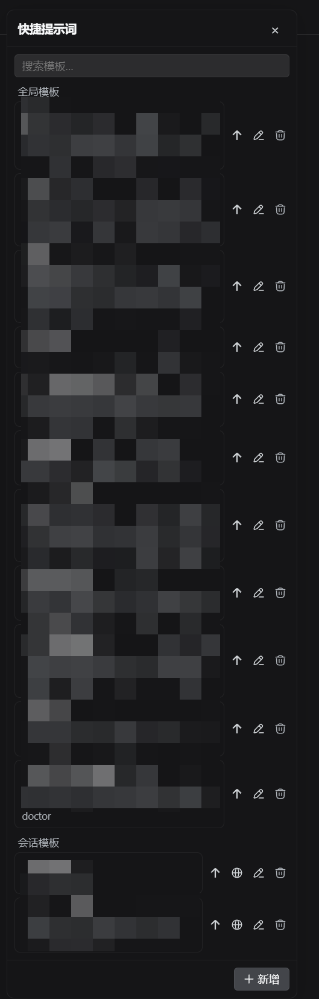

# @nelsonlongxiang/dsh-prompt-templates

[English](README.md) | 中文

[](https://www.npmjs.com/package/@nelsonlongxiang/dsh-prompt-templates)

[DeepSeek Harness](https://github.com/deepseek-ai/deepseek-harness) 快捷提示词模板：全局与会话级模板、右侧浏览器面板、纯 TS 的 `node:sqlite` 持久化——一个自包含插件，`dsh plugin` 即装。



## 安装

```sh
dsh plugin --profile web add @nelsonlongxiang/dsh-prompt-templates
```

重启 `dsh web`，在输入框工具行找到模板按钮。0.12.0 起同一模板库还入驻**右侧栏 tab**：从侧栏 `+` 引导页（“提示词模板”入口）打开——它与对话同屏共存、不遮 composer，且始终作用于侧栏正在查看的会话。宿主没有侧栏服务时 tab 静默不激活，悬浮面板照常可用。

无需 Python 工具链——0.3.0 起 host 面直接通过 `node:sqlite`（Node ≥ 24）在宿主进程内持久化，读写原来 Python 子进程持有的同一个 `$DSH_HOME/ext/prompt-templates/db.sqlite3`（数据零迁移）。

## 你能得到什么

- **全局 + 会话模板**——全局处处生效；会话模板只属于当前对话，一键提升为全局
- **定时自动注入**——每条模板独立开关 + 间隔 N：开启后 host 在对话每第 N 轮的首个请求自动注入该模板，配置持久化于 SQLite，注入本身落为持久会话事件；模板库工具栏的 `⟳N` 徽标可点开查看本会话最近 20 次注入（轮次、时间、模板名、注入正文）
- **模板变量**——内容支持 `{{date}}` `{{time}}` `{{datetime}}` `{{weekday}}` `{{session}}` `{{turn}}`，在插入、直发、插话、定时注入时展开；值不可得时保留原文字面，存储始终保存原始文本
- **跨实例分享**——单模板或整类目一键复制为剪贴板载荷；目标实例「导入」粘贴即用，同名模板有显式覆盖确认
- **插入或直发**——一键插入到 composer 光标处（或替换当前选区）；send-now 立即发送；编辑、删除、转全局都在行内
- **右侧栏 tab**——完整模板库可停靠为侧栏 tab（DSH ≥ 0.2.x）：从 `+` 引导页打开，跟随当前查看的会话；悬浮面板保留作快捷一次性使用
- **搜索与滚动**——边输入边过滤，长列表滚动可靠
- **拖拽定位、双击复位**——面板记住你放的位置
- **设计即持久**——模板经纯 TS 存储（`node:sqlite`）落 SQLite，由 host 插件持有并随其生命周期关闭
- **卡库与介入记录**（0.16）——模板带生效版本；版本包（`packs/`）导入只存为新版本，不切换正在用的版本；模板内容每次进入会话都留一条持久记录（标识、版本、文字哈希、会话、轮、步），不记正文。见[卡库导入](docs/library-packs.md)
- **收尾自查与投卡**（0.17）——收尾自查让有活的会话在本来结束的一轮多走一步；属主 2026-11-21 裁定改为默认开（已在 master，尚未随包发布，0.17.0/0.18.0 包里仍默认关），写 `selfCheck.enabled: false` 关闭。`cast.enabled`（默认关）让点名的插件向会话投一张卡。见[收尾自查合同](docs/self-check.md)
- **体会与交接通知**（0.18）——体会按同一裁定改为默认开（仅 master，0.18.0 包里默认关；写 `lessons.enabled: false` 关闭），让会话写下一两句体会（存为它自己的会话模板，归「体会」分类），同类情境下带回；交接通知跟随事件提醒的开关（默认关）：提醒次数用完后同一问题再重复，发一次通知，请会话停止自行反复修正、交给属主。细节见源码仓的 `docs/spec-lesson-inject.md` 与 `docs/release-notes-0.18.0.md`

## 分享（跨实例复制）

- 行内 ⧉ 按钮分享**单模板**；类目 tab 旁 ⧉ 分享**整类目**（成员模板 + 类目定义）
- **分享模板 JSON / 分享分类 JSON** 传递带 `format`/`version` 标记的分享载荷，不是单独的提示词正文；无文件、无网络。
- 自动复制先用浏览器 Clipboard API，再尝试兼容复制命令；两者都失败时展示只读的**手动复制分享 JSON** 面板，保留完全相同的载荷。全选后按 Ctrl+C / ⌘C，再粘贴到目标实例的导入框。面板区分 API 缺失、页面未聚焦、写入拒绝和安全限制，不据此判断系统剪贴板损坏。
- 限制取决于浏览器与页面环境：普通局域网 HTTP 可能缺该 API；`http://127.0.0.1` 等回环来源虽用 HTTP 也可能属于可信来源。无需修改全局安全设置，也不会读取剪贴板。
- 目标实例工具栏「导入」粘贴解析：缺失类目自动补建；**同名同域模板弹覆盖确认**——覆盖＝更新现有模板（内容/描述/分类/注入配置），拒绝＝跳过；完成提示「新建/覆盖/跳过」三计数
- 分享的是**原始文本**：`{{date}}`/`{{turn}}` 等变量在目标实例投递时按其上下文重新展开

## 定时自动注入

每条模板（全局或会话级）都带独立的**开关 + 间隔 N**。开启后，host 在对话每第 N 轮的第一个请求注入该模板——N=5 即第 5、10、15…轮；轮次按"用户输入→助手回复"计数，重启后序号延续。

- 注入内容是一条持久的 `<system-reminder>` 用户消息，记入会话日志（source kind `prompt-template-schedule`），重放与审计可精确还原模型所见
- 同一边界轮绝不重复注入——跨重启、跨步骤重试都不例外
- 配置持久化在插件 SQLite 库（0.18.0 起数据库 schema v11，含演化模板登记；以 `src/store.ts` 的 `SCHEMA_VERSION` 为准）；patch 配置里的 `injectEnabled: false` 只关**定时注入**——事件提醒（见下）有独立总开关 `eventInject.enabled`，互不控制
- 每条模板可选交付模式：**静默**（默认，只进模型上下文）或**对话流可见**（以普通用户消息渲染，带 ⚙️ 定时注入标记）

## Atelier 演化自评估（0.15.0 起）

默认按会话补充 `工坊·演化自评估`，每100用户轮次调用 Agent Atelier 指引；已有同名模板、编辑、关闭和删除不被覆盖。仅提醒，不执行迁移或授予权限。可用 `evolutionAssessmentEnabled: false` 停用。首次历史边界不追补、升级/退出/回滚详见 [演化自评估合同](docs/evolution-default.md)。

## 事件提醒（默认关闭）

除了按固定轮次，插件还可以**根据刚发生的行动**提醒 Agent：观察工具的最终结果，识别两类问题——**重复准备**（反复手工带上同一段前缀，比如环境变量加解释器绝对路径，任务部分不同）和**重复失败**（同一目标以相同方式反复失败，或成功后又失败）——然后在下一次模型决策前追加一条短提醒，包括定时注入会跳过的工具结果那一步。

- 两级开关串联：总开关保存在插件数据库中（面板 ⚙ 下拉可直接切换，即时生效、无需重启；部署配置 eventInject.enabled 的值只在首次读取时作为种子）＋每条规则自己的开关、门槛/冷却与只读问题台账。属主 2026-11-18 裁定：总开关由仅部署配置改为面板持有，推翻 2026-11-14 的部署专属取向。
- 介入时机：工具结果落地之后、**同轮下一次模型决策之前**追加提醒。它拦不住首次违规，也撤销不了已发生的副作用或已并行发出的兄弟调用
- 存的是什么：指纹（哈希）加一条长度受限、启发式脱敏的参数摘要。不整存原始参数/输出，但摘要仍可能带上未被掩码的参数片段；摘要永不作为指令或授权
- 失败分类优先取 `isError` 及错误码，再取整数 `meta.exitCode`（含零）；只有元数据没有有效退出码时，`bash` 适配才读取最后一个文本片段的精确尾行 `[exit code: N]`。输出里的成功／失败等任意措辞不改变分类；命令也能自行打印同形标记，因此回退存在误报可能。`ok` 仅代表工具层完成，不等于任务已验证成功。字段优先级、记录宿主限制与未测项见[失败契约](docs/event-failure-contract.md)。
- 有预算：默认每个**用户轮**最多一条（长自治轮因此最多一条）、有字数上限、每条规则有冷却（默认 3 轮）、每个问题有次数上限；没有新证据就不提醒
- 投递是"至少一次 + 按会话日志去重"，重启或步骤被拒都不会丢失或重复
- 插件只把问题标到 `notified`。`changed` / `repeated` 只是弱行为信号不是结论：同工具跑一条无关命令也可能翻转它。结案（`verified`、`rejected` 等）走 `PATCH …/event-episodes/<id>`，必须带证据引用——只有完整轨迹复核才算验证完成
- 提醒是 user-role 消息：不是用户指令，不授予权限。Agent 该怎么处理以 Agent Atelier 的 `references/improvement-loop.md` 为准；设计见 [docs/spec-event-inject.md](docs/spec-event-inject.md)

## 模板变量

模板内容中的 `{{date}}` `{{time}}` `{{datetime}}` `{{weekday}}` `{{session}}` `{{turn}}` 在**投递时**展开——插入、直接发送、插话打断、定时注入四条路全部生效：

- 时钟类（date/time/datetime/weekday）取本地时钟；`{{session}}` 为目标会话 id；`{{turn}}` 仅定时注入路径可得（插入/直发时保留原文字面）
- 未知变量名原样保留，不静默删除；模板表单内有变量提示行
- 存储始终保存原始文本，展开只发生在投递瞬间——历史下拉里看到的就是实际送出的内容

## 工作原理

```text
src/                  TypeScript 插件（host 面 + 浏览器面）
  index.ts            Host：持有 TS 存储，暴露 HTTP 路由
  store.ts            纯 TS 存储（node:sqlite，数据库 schema v11）
  inject.ts           Host：挂在 pre-step waterfall 上的定时注入
  invariant.ts        Host：注册本包的 invariant 伴生插件
  cli/                随 bin 发布的同步 CLI（export/diff/merge/import）
  client/             浏览器：共享模板库，同时挂载为 shell.overlay
                      悬浮面板与右侧栏 tab body（sidebar.right.pane.tab），
                      外加 conversation.input.right 开关按钮
cordis.patch.yml      Bundle patch：挂插件行
```

存储是 host 面内的纯 TS 实现；不拉起任何子进程。

## 安全

- 模板**内容**进入模型请求只有两条路：用户主动插入的普通用户文本，或经定时注入通道。用户模板按已保存的开关执行；0.15.0 起发布的 Atelier 演化默认项在每会话首次创建时启用，可由部署退出，用户仍可编辑、关闭或删除。每次实际投递均记为持久会话事件。收尾自查（`selfCheck.enabled`）与体会（`lessons.enabled`）是另外两条注入路径，master 上自 2026-11-21 起默认开，部署配置写 `false` 关闭；投卡（`cast.enabled`）仍默认关。事件提醒是独立通道：不携带模板内容，开关也与定时注入互不控制
- 面板仅经 Host 的插件路由访问 host 存储；无额外监听、无外联网络

## 数据同步 CLI

包内提供确定性的本地 CLI，用于跨 DSH home 对比、合并提示词模板数据库；禁止直接远程写库。

```sh
# 导出 schema-v4 快照（确定性排序 + data_sha256）
dsh-prompt-templates export --db /path/to/db.sqlite3 --out snapshot.json --output=json

# 对比快照（加 --fail-on-diff 时发现差异返回 exit 1）
dsh-prompt-templates diff left.json right.json --output=json --fail-on-diff

# 只生成合并 JSON；同时间异内容或同名异 ID 默认阻断
dsh-prompt-templates merge base.json incoming.json --strategy newer --out merged.json --output=json

# 导入默认只 dry-run：先审核 summary_sha256 与数据库 hash
dsh-prompt-templates import --db /path/to/db.sqlite3 --in merged.json --output=json

# 显式 apply 才写；绑定两个已审核值，先备份，再执行单事务
dsh-prompt-templates import --db /path/to/db.sqlite3 --in merged.json --apply \
  --expect-db-sha256 <db-sha256> --confirm-summary-hash <dry-run-summary-sha256> --output=json
```

`import` 仅按模板 ID 插入/更新，绝不自动删除；未知字段、错误 schema、hash 漂移、同名异 ID，以及超过 `--max-changes`（默认 100）的变更均阻断。schema-v2 快照（无注入字段）仍可导入——注入项默认关闭；导出恒为 schema v4（仅模板与类目，不含事件策略及运行状态）。

## 目录定义

声明的目录布局——根级白名单之外即散落，巡检门（`scripts/patrol.sh` 的 dir convention 段）会判失败：

| 路径 | 职责 |
|---|---|
| `src/` | 宿主插件、CLI 与浏览器客户端源码 |
| `scripts/` | 可重跑运维入口：`patrol.sh`、`branch-audit.sh`、`remote-heads.sh`、`push-master.sh`、`release.sh` |
| `docs/` | 面向人的文档：spec、发布说明、交接指南；npm 包仅携带白名单明确列出的使用／验收说明 |
| `tests/` | `pnpm verify` 背后的 `node:test` 套件 |
| `images/` | README 引用的静态图 |
| `tmp/<任务>/` | 已忽略的临时区；自动测试经 `tests/temp-dir.mjs` 使用 `tmp/test-runs/`；限任务生命周期，永不入库 |
| `lib/`、`node_modules/` | 构建产物与依赖——忽略，永不入库 |
| `.npmrc`、`.claude/`、`.obelisk/` | 本地工具状态（registry 配置、工坊 junction、代理记忆）——忽略，永不入库 |

## 开发

```sh
pnpm install
pnpm verify            # 日常门禁（本地与 CI）
pnpm verify:release    # pnpm verify 的别名
```

推送前跑 `pnpm verify`。它不启动 DeepSeek Harness 进程，顺序为：

1. **typecheck** — host 与 client 两个工程的 `tsc --noEmit`
2. **test:cli** — `node:test` 跑 `tests/*.test.ts`：CLI 同步、store 规则、schema 迁移、注入纯函数、client 过滤，以及进程内 host 检查。该检查把 `apply()` 挂到 Cordis 上，用替身 web server 驱动 `/plugins/dsh-prompt-templates` 路由（含 inject-status），并对一份假会话日志跑 `agent/pre-step` 监听器
3. **build** — host `tsc`、client `tsc`、tsdown 浏览器 bundle
4. **test:package** — `lib/client.js` 含全部 CSS module class，再 `npm pack` 并跑打包后的 `dsh-prompt-templates --help`

GitHub Actions（`.github/workflows/verify.yml`）在指向 `master` 的 push / pull request 以及 `v*` tag 上用 Node 24 跑同一命令。`test:cli` 还含 DSH 0.2.x 契约测试（peer 版本线 / patch 沙箱 / store 真执行 / slot 声明 / 图标导出），上游漂移当场爆红。仓库 `scripts/` 提供运维稳定入口（分支预算审计 / 吸收分类 / 隐私排查推送）。`@deepseek-ai/*` devDependencies 来自公网 npm，CI 不需要 registry token，也不需要 harness 检出。

构建后运行 `node tests/clipboard-browser.mjs zh`（或 `en`）可生成自包含分享测试页，内含合成复制场景和只读环境检查；隐私边界与 macOS 复验步骤见[复制验收说明](docs/clipboard-verification.md)。生成/解析页面不等于浏览器验收。

仍需人工、因为它们依赖真实 harness profile：启动 `dsh web`、浏览器面板对接真实 web server，以及用真实会话日志验证 resume / compaction。

### 维护者发布流程

发布需另有属主明确授权。`bash scripts/release.sh "<主题>"` 只允许在 **master** 上执行，输入仅限两种：

- 仅改版本号的 package bump，加本版非空发布说明；其他变更已入主干，当前 HEAD 与远端 master 一致；或
- 已提交且干净的精确 `chore(release): <版本> — <主题>` 提交，仅含本版 bump 与说明。未推历史最多这一条提交。

首次发布前续接必须传相同主题。主题首尾空白在 verify／提交前直接拒绝，不静默修剪，以免 Git 修剪标题后造成身份不一致。生成发布提交前会核对暂存路径与 Git 规范化后的 blob，提交命令限定为本版两个路径，不吸收外来暂存；启用 CRLF 规范化时仍用原始工作文件摘要检测材料漂移。脚本在 verify／publish 之前核对分支、包身份、允许路径、实际远端 master、本地／远端版本标签剥离后的目标，并在 verify 后重查 HEAD、材料与暂存 blob。冲突即拒绝，不自行切分支、不改写已有标签；远端标签已指向验证提交时无需推送，即使两端标签对象不同。

`DRYRUN=1 bash scripts/release.sh "<主题>"` 只走预检和正常 verify／构建门，不生成发布提交、不 publish／tag／push／创建 GitHub Release。它不是“零落盘”：常规构建与测试临时物仍会生成。

拉回直验只用本次拥有的忽略目录 `tmp/release/run-*/`；EXIT／INT／TERM 仅清理路径与所有权标记均相符的目录，身份不符则保留排查。这是拒绝式预检，不是文件系统沙箱，也不是阻止并发写入的锁。

**发布后不盲重试**：脚本不自动重发，也不是任意阶段的恢复器。registry 已接受版本、publish 超时或结果未知时，必须先对该 registry 对账；不能为续做后面的 push／tag／Release 而重跑整条链。自动回归只用新建合成 Git 仓与离线命令 stub，不代表真实发布或生产部署已验证。

## 已知限制

- **会话模板需要当前会话**——无会话打开时只能用全局模板
- **注入不在对话流中渲染**——DSH 对话视图按设计省略注入的 context 行（消息 source 非 `user`）；可在轨迹 tab 查看。交付模式为"对话流可见"的模板是例外：以普通用户消息渲染
- **自查、投卡、体会与交接通知尚未在真实宿主上验证**——模型行为 NOT_RUN；自查与体会已改为默认开，升级在用的宿主前先在独立 `DSH_HOME` 验证（[测试计划](docs/test-plan-phase-c.md) §7）
- **面板手动发卡的记录没有轮和步**——面板的插入、直发、插话所写的介入记录，`turn`、`step` 按设计为空。插入只是把文字放进输入框，可能根本不发，本来就没有所属轮次；直发与插话落在哪一轮、哪一步，要等宿主处理到那条消息才知道，而宿主只在每一步开始前的事件里给出轮与步，没有按会话查当前轮的接口，所以记录不去猜。按轮次、按事件、投卡与收尾自查的记录都带真实轮次
- **正式使用优先安装 npm 发布构建**——Git／源码安装会执行 `prepare` 构建，需要开发工具链和依赖。本仓所述验证门禁使用公网 `@deepseek-ai/*` 包，不需要 harness 源码检出；该门禁没有验证直接 Git-URL 安装。使用预构建包请运行 `dsh plugin --profile <name> add @nelsonlongxiang/dsh-prompt-templates`。

## 许可证

MIT
